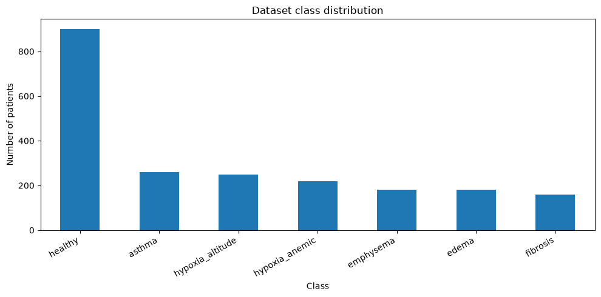
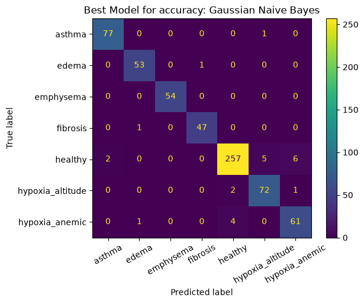

# Synthetic Pulmonary Disease Classification

[](https://www.python.org/)
[](https://github.com/SergioPascualRedondo/Synthetic-Pulmonary-Disease-Classification/actions/workflows/ci.yml)
[](LICENSE)
[](docs/methodology.md)

A reproducible machine-learning project that generates a physiology-inspired synthetic pulmonary dataset and compares classifiers across seven respiratory and hypoxia-related patterns.

> **Educational project — not a medical device.** The dataset is simulated and the models must not be used for diagnosis, triage, or patient care.

## Project overview

The project models seven classes:

- `healthy`
- `hypoxia_altitude`
- `hypoxia_anemic`
- `asthma`
- `edema`
- `fibrosis`
- `emphysema`

Fifteen features represent demographics, vital signs, gas exchange, acid–base status, oxygen transport, spirometry, diffusion, imaging surrogates, and congestion. Data generation includes class imbalance, noise, and overlapping distributions so that classification cannot be reduced to hard-coded rules.



## Repository structure

```text
.
├── data/processed/                 # Reproducible synthetic dataset
├── docs/                           # Methodology, data dictionary, reproducibility
├── notebooks/                     # Clean analysis notebook
├── reports/                       # Executed baseline and regenerated reports
├── scripts/reproduce.py           # One-command notebook execution
├── src/pulmonary_disease/         # Reusable data-generation package
├── tests/                          # Determinism and validity checks
├── environment.yml                # Conda environment
├── pyproject.toml                 # Package and dependency definition
└── requirements.txt               # pip installation
```

## Quick start

### Option 1 — pip

```bash
git clone https://github.com/SergioPascualRedondo/Synthetic-Pulmonary-Disease-Classification.git
cd synthetic-pulmonary-disease-classification

python -m venv .venv
# Windows
.venv\Scripts\activate
# macOS/Linux
source .venv/bin/activate

python -m pip install --upgrade pip
python -m pip install -r requirements.txt
python scripts/reproduce.py
```

The executed notebook is written to `reports/pulmonary_disease_classification_executed.ipynb`.

### Option 2 — Conda

```bash
conda env create -f environment.yml
conda activate pulmonary-disease-ml
python scripts/reproduce.py
```

To explore interactively:

```bash
jupyter lab notebooks/pulmonary_disease_classification.ipynb
```

## Reproducibility

- The random seed is fixed at `42`.
- The dataset is regenerated from source code on every clean run.
- Tests verify determinism, schema, class counts, missing values, and physiological bounds.
- The CI workflow runs the test suite on every push and pull request.
- The original executed baseline is retained in `reports/baseline_executed_notebook.ipynb` for provenance.

See [Reproducibility](docs/reproducibility.md) for the full protocol.

## Analysis workflow

1. Generate a synthetic cohort using physiology-inspired relationships.
2. Validate schema, missingness, ranges, and class balance.
3. Explore distributions, correlations, and between-class overlap.
4. Create a stratified train/test split.
5. Tune Decision Tree, Gaussian Naive Bayes, and Random Forest models.
6. Compare accuracy and macro-averaged precision, recall, and F1.
7. Inspect confusion matrices and permutation importance.



## Documentation

- [Methodology and assumptions](docs/methodology.md)
- [Data dictionary](docs/data_dictionary.md)
- [Reproducibility protocol](docs/reproducibility.md)
- [Contributing guide](CONTRIBUTING.md)

## Known limitations

- Synthetic labels are generated from the same latent mechanisms that shape the features.
- The dataset has no external or clinical validation.
- Simplified physiological relationships do not capture all comorbidities, treatments, measurement artifacts, or demographic effects.
- High model performance on synthetic data does not imply clinical usefulness.
- A stronger next version should add calibration, nested cross-validation, uncertainty analysis, leakage checks, and external validation planning.

## Author

**Sergio Pascual Redondo**

## License

Code is released under the [MIT License](LICENSE). The synthetic dataset is included for educational and research demonstrations.

