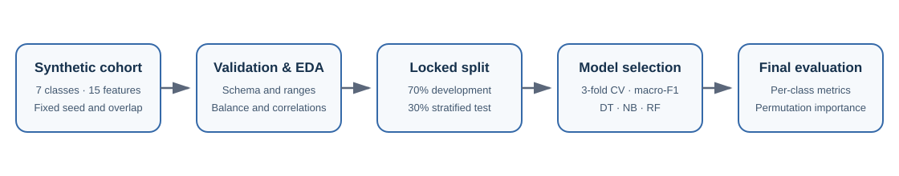
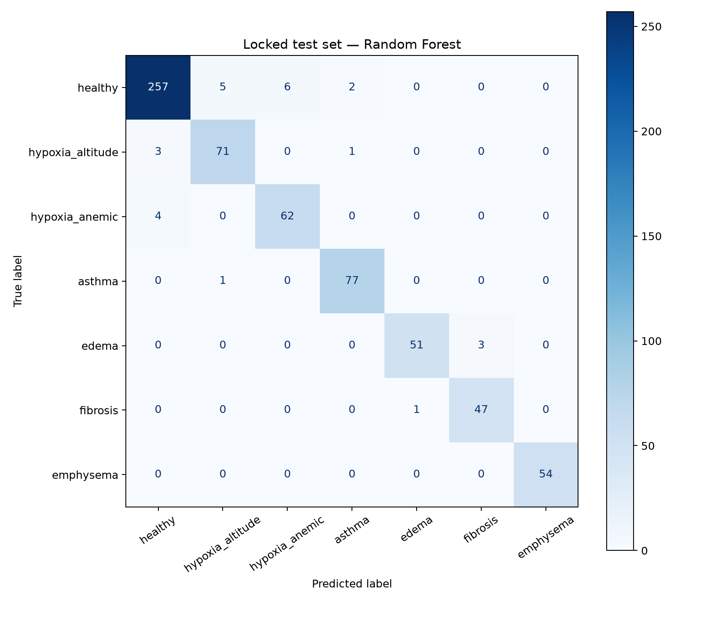
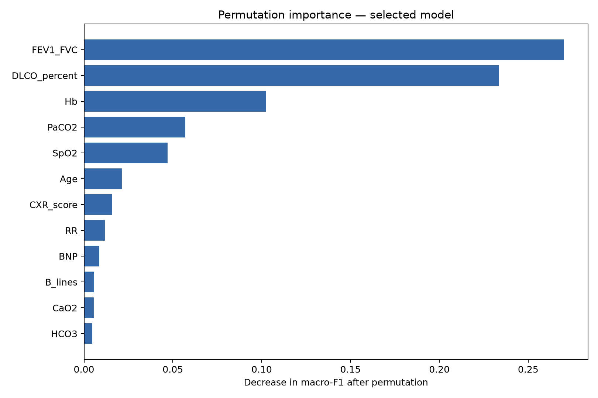

# Can Synthetic Physiology Distinguish Pulmonary Disease Patterns?
## A Reproducible Multiclass Machine Learning Analysis

[](https://www.python.org/)
[](https://github.com/SergioPascualRedondo/Synthetic-Pulmonary-Disease-Classification/actions/workflows/ci.yml)
[](LICENSE)
[](docs/methodology.md)

AI for Medicine project using a physiology-inspired synthetic pulmonary dataset.

The goal is not only to classify seven respiratory and hypoxia-related patterns, but also to build a fully reproducible workflow in which data generation, validation, model selection, final evaluation, and interpretation are clearly separated.

The seven classes are:

1. Healthy
2. Altitude-related hypoxia
3. Anemic hypoxia
4. Asthma
5. Pulmonary edema
6. Pulmonary fibrosis
7. Emphysema

> **Educational project — not a medical device.** The data are simulated and the models must not be used for diagnosis, triage, or patient care.

## Main Files

```text
notebooks/pulmonary_disease_classification.ipynb   Main executable notebook
data/raw/synthetic_pulmonary_dataset.csv           Versioned synthetic dataset
src/                                                Reusable Python modules
scripts/generate_results.py                         Regenerates saved figures and tables
scripts/reproduce.py                                Executes the notebook in a clean kernel
results/figures/                                    Saved analysis plots
results/tables/                                     Saved model results
docs/                                               Methodology and data dictionary
requirements.txt                                    Pinned Python environment
```

## Method

The dataset contains 2,150 simulated observations and 15 clinical features covering demographics, vital signs, gas exchange, acid–base balance, oxygen transport, spirometry, diffusion capacity, imaging surrogates, and congestion.

The modelling workflow uses:

- a fixed random seed for deterministic data generation;
- explicit schema and physiological-range validation;
- a locked 30% stratified test set;
- 3-fold cross-validation on the development set;
- hyperparameter tuning using macro-averaged F1;
- Decision Tree, Gaussian Naive Bayes, and Random Forest classifiers;
- final per-class metrics and confusion-matrix analysis;
- permutation importance for model interpretation.

Model selection is based only on development-set cross-validation. The locked test set is used once for descriptive final evaluation, reducing optimistic selection bias.



*Figure 1. Reproducible workflow from physiology-inspired cohort generation to locked-test evaluation and interpretation.*

## How to Run

Clone the repository, create an environment, and install the pinned dependencies:

```bash
git clone https://github.com/SergioPascualRedondo/Synthetic-Pulmonary-Disease-Classification.git
cd Synthetic-Pulmonary-Disease-Classification

python -m venv .venv
```

Activate the environment on Windows:

```powershell
.venv\Scripts\Activate.ps1
```

Or on macOS/Linux:

```bash
source .venv/bin/activate
```

Then install and reproduce the saved results:

```bash
python -m pip install --upgrade pip
python -m pip install -r requirements.txt
python scripts/generate_results.py
python scripts/reproduce.py
```

To explore the analysis interactively:

```bash
jupyter lab notebooks/pulmonary_disease_classification.ipynb
```

## Main Results

The Random Forest was selected because it achieved the highest development-set cross-validated macro-F1. Gaussian Naive Bayes produced a slightly higher locked-test score, but the test set was not used to change the selected model.

| Model | Development CV macro-F1 | Test accuracy | Test macro-F1 |
| --- | ---: | ---: | ---: |
| Random Forest | 0.962 | 0.960 | 0.960 |
| Gaussian Naive Bayes | 0.961 | 0.963 | 0.964 |
| Decision Tree | 0.907 | 0.927 | 0.926 |

The selected Random Forest reached a test macro-F1 of 0.960. Class-level F1 ranged from 0.925 for anemic hypoxia to 1.000 for emphysema. These values reflect the internal consistency of the simulator and must not be interpreted as clinical performance.



The strongest permutation-importance signals are available in the versioned explainability table and figure:



## Repository Structure

```text
.
├── data/
│   └── raw/
├── docs/
├── notebooks/
├── reports/
├── results/
│   ├── figures/
│   │   ├── eda/
│   │   ├── explainability/
│   │   └── final_test/
│   └── tables/
│       ├── cv/
│       ├── explainability/
│       └── final_test/
├── scripts/
├── src/
│   └── pulmonary_disease/
├── tests/
├── pulmonary_disease_pipeline.svg
└── requirements.txt
```

## Reproducibility

The repository includes:

- a fixed random seed;
- pinned package versions;
- a versioned synthetic dataset;
- saved result tables and figures;
- source code separated into helper modules;
- deterministic dataset tests and continuous integration;
- the original executed notebook for provenance.

See the [reproducibility protocol](docs/reproducibility.md), [methodology](docs/methodology.md), and [data dictionary](docs/data_dictionary.md) for details.

## Limitations

- Labels and features originate from the same simulated mechanisms.
- The dataset has no external or clinical validation.
- Simplified physiological relationships cannot capture all comorbidities, treatments, demographic effects, or measurement artifacts.
- High performance on synthetic data does not establish clinical usefulness.

## Author

**Sergio Pascual Redondo**

## License

Code is released under the [MIT License](LICENSE). The synthetic dataset is included for educational and research demonstrations.
